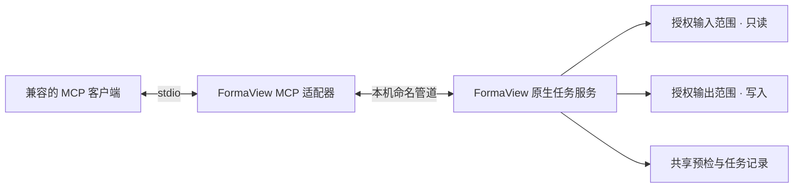

  
  <h1>FormaView</h1>
  
<strong>面向素材检查与导出的本地桌面工作区</strong>

  
浏览图片、模型和动画；检查细节；预检并安全地导出转换结果。

  
<strong>开发版本 0.1.0</strong> · Windows x64 · 简体中文 / 繁體中文 / English

> [!NOTE]
> FormaView 仍在开发中，第一版尚未正式发布。目前没有正式安装器或稳定版下载。本文介绍当前开发版本的产品能力和使用方式，不能视为完整兼容性承诺。

## 目录

- [FormaView 是什么](#formaview-是什么)
- [适用场景](#适用场景)
- [当前功能](#当前功能)
- [支持格式与边界](#支持格式与边界)
- [使用指南](#使用指南)
- [MCP 集成](#mcp-集成)
- [运行环境](#运行环境)
- [版本规则与路线图](#版本规则与路线图)
- [常见问题](#常见问题)
- [数据安全与第三方许可](#数据安全与第三方许可)

## FormaView 是什么

FormaView 是一款 Windows 桌面素材浏览、检查和转换工具，服务于需要快速查看大量图片、模型和动画文件，并在导出前确认结果的内容创作者与技术美术。

它把文件浏览、专业预览和批量转换放在同一个工作区。预览用于检查源素材；转换是单独的导出流程，要求用户指定输出位置，并在写入前查看预检结果。

## 适用场景

- **快速找素材**：从磁盘或目录浏览文件，使用搜索、筛选、排序、列表或缩略图定位目标。
- **检查纹理**：查看颜色通道、Alpha、尺寸、元数据、DDS 子资源和 EXR 图层；按适合窗口或源像素比例查看图像。
- **检查模型**：查看网格、UV、材质引用、骨架、蒙皮权重、LOD 和碰撞，辅助发现缺失或异常数据。
- **检查动画**：播放模型内动画，或为模型添加外部动画；对照骨架并查看动作片段。
- **批量导出**：设定格式、命名规则和冲突处理方式，先查看每个输入的预检结果，再提交批量任务。
- **连接 AI 工作流**：可选启用 MCP，让兼容客户端在明确授权的输入与输出范围内检查素材、准备预检计划和管理任务。

## 当前功能

### 文件工作区

- 浏览本地磁盘和目录，使用面包屑地址、前进/后退和上级目录导航。
- 按文件名搜索，按名称等条件筛选或排序；通过“文件显示方式”选择列表、缩略图或平铺布局。
- 在文件区快速跳转到系统桌面；前进和后退可返回之前浏览的位置。
- 使用键盘连续切换文件，也可通过 `Ctrl` 或 `Shift` 多选。
- 预览面板根据文件类型显示内容与可用信息；文件扩展名只用于识别候选类型，不保证文件内容一定可读取。

### 图片与纹理

- 查看常见位图、纹理及高动态范围图像。
- 切换 RGB、R、G、B、A 通道，查看 Alpha 合成、曝光、平铺和像素读数。
- 查看尺寸、通道类型、Alpha 解释、子资源、DDS mip/数组/面等可用信息，以及 EXR 图层。
- 转换时可以设置输出格式、通道映射、Alpha 处理、数值类型、质量或压缩选项。预检会列出兼容性问题和可能的信息损失。

### 模型与动画

- 预览模型并切换模型、UV、权重和 LOD/碰撞检查视图。
- 检查材质引用、UV 集、骨架层级、蒙皮绑定和源权重；可切换线框、地面网格和坐标轴。
- 预览 Alembic（ABC）Ogawa 文件中的多边形几何缓存，可按采样时间浏览固定或变化拓扑，并查看文件实际提供的 UV 与法线；ABC 不推断骨架或蒙皮权重。
- 在 FBX 和 ABC 预览中查看资产相机、取样时的世界位置、视锥与运动轨迹；可选择相机并读取投影、焦距、filmback、视角和裁剪参数。只有相机的文件也可进入模型预览。缺失的参数明确显示为不可用；ABC 不声明场景长度单位。资产相机仅用于检查，不会接管预览视角。
- 播放动画、选择动作片段、控制速度和循环；支持为模型添加外部 FBX 动画，或为 ActorX 数据选择 PSA 与参考 PSK/PSKX 配对。
- 可比较支持格式间的骨架结构。动画与模型能否配对取决于骨骼名称、层级、参考姿势及源数据质量，需查看软件给出的检查结果。
- 可将支持的模型或动作导出为 FBX；可设置动作片段、坐标系、单位、命名和配对规则，并在提交前预检。ABC 可将预览中的当前采样导出为静态 FBX 几何快照，不导出 ABC 时间序列或骨骼动画。当前不提供动画重定向。

### 转换与任务

- 从“转换”流程选择图片、模型或动画输入，设置输出目录、命名规则、任务信息和冲突策略。
- 图片可选择目标格式和通道/Alpha/数值策略；模型与动画可选择导出内容、片段和输出约定。
- 预检逐项检查输入快照、目标路径、冲突、格式兼容性和信息损失。预检本身不会写出转换结果。
- 提交后在任务区域查看排队、进行中、成功、部分成功、失败或取消状态；可查看逐项结果，并对符合条件的失败项目重新预检。
- 对已有输出可选择跳过或重命名；覆盖需要显式允许。输出不得覆盖本次输入素材或其硬链接。

## 支持格式与边界

表格表示当前版本存在相应处理入口。具体文件仍须经过读取检查或转换预检；压缩方式、通道布局、私有扩展和数据质量都可能影响结果。

| 类别 | 当前格式 | 可用能力与注意事项 |
|---|---|---|
| 图片 / 纹理读取 | PNG、JPEG（JPG/JPE/JFIF）、BMP（DIB）、TGA、TIFF、WebP、GIF、ICO、DDS、HDR/RGBE、EXR | 图片预览与可用元数据检查；GIF 支持播放/暂停、循环、逐帧步进与时间轴拖动，并可把合成后的各帧无损导出为独立 PNG。DDS 可包含多个子资源；EXR 的 Deep、子采样通道等变体不在普通图像路径范围内 |
| 图片导出 | PNG、JPEG、BMP、TGA、TIFF、WebP、DDS、HDR、EXR | 输出选项随目标格式变化；有损压缩、量化、Alpha 删除或数值范围变化会在预检中报告 |
| 模型预览 | FBX、OBJ、glTF、GLB、PSK、PSKX | 查看模型、UV、骨架/绑定、权重、LOD 与碰撞；不承诺支持这些格式的全部版本和私有变体 |
| 几何缓存预览 | Alembic ABC（Ogawa） | 当前源码支持多边形几何缓存、相机、采样时间轴与可用 UV/法线；允许只有相机的文件；不支持 HDF5、曲线、点、细分曲面等其他 schema，也不提供骨架/权重检查 |
| 动画读取 / 预览 | FBX、glTF、PSA | 可读取模型内动画；PSA 等独立动画需要合适的模型/参考骨架才能完整配对 |
| 模型 / 动画导出 | FBX | 输入包括支持的 FBX、OBJ、glTF/GLB、PSK/PSKX/PSA；ABC 仅可将预览当前采样写为静态几何快照，不输出 ABC 动画序列；PMX、VRM 当前作为转换输入，不提供专业模型视口预览 |

**当前不支持**：常规视频解码播放、Unity `.unitypackage` 内容预览、Markdown、PDF、字体和 PSD 预览。这些项目已列入后续规划，但尚未包含在 0.1.0 中。

ABC 支持仅限上表所列的 Ogawa 多边形缓存与相机预览；含几何的文件可将当前采样导出为静态 FBX 快照。导出会烘焙顶点变换；分组层级可保留为空节点，但不保留各部件的旋转中心/轴心。单位按可识别的写出程序约定，否则按米并提示。ABC 容器写出、ABC 动画序列导出和骨骼动画生成均不支持。具体运行目录是否包含这些源码能力，以该目录对应的构建与说明为准。

相机显示采用源文件的变换和参数。FBX 的局部相机轴向仅在解析器能确认时标注；ABC 相机按局部 −Z 前向、+Y 向上展示，视角由 filmback 和焦距推导。ABC 相机裁剪距离按 Alembic 相机 schema 的厘米约定读取，但世界位置的场景单位未知。相机轨迹是有上限的采样折线，不代表连续曲线的全部细节。

图片解码器和模型解析器会基于文件内容及结构检查能力，而不是只根据扩展名判断。运行目录中实际可用的图片和模型转换能力，可能随运行组件而异。

### 图片导出选项

转换设置按目标格式显示可用选项；最终是否适用由预检确认。

| 目标 | 可配置内容 | 需要留意 |
|---|---|---|
| PNG | 通道映射、Alpha 策略、数值类型；无损压缩级别 | 压缩级别只改变编码速度和文件大小，不改变画质 |
| JPEG | 通道映射、质量 | 有损格式，不保留 Alpha；有损转换需确认预检损失 |
| WebP | 通道映射、Alpha、质量、无损/有损模式 | 有损模式需要确认损失；Alpha 类型必须与来源数据匹配 |
| TIFF | 通道、数值类型、无压缩或 LZW/Deflate/PackBits 压缩 | 可用数值与通道组合取决于编码器支持 |
| DDS | 源格式或 RGBA8、RGBA32F、BC1、BC3、BC5、BC6H、BC7 等目标 | 部分 BC 格式为有损压缩；预检显示具体编码和损失 |
| HDR | 通道及数值策略 | Radiance RGBE 不保留 Alpha 或负值，并可能损失数值精度 |
| EXR | 通道、half/float 数值类型；可选 64×64 tiled / ZIP | Deep、子采样通道等结构不在普通图像路径范围内 |

JPEG、BMP、TGA 等其他目标也会依据源通道、数值范围和目标编码能力进行预检。源 Alpha 类型未知或目标不能表达相应数据时，软件会要求明确处理方式或拒绝转换，不会静默丢弃信息。

## 使用指南

### 浏览与预览素材

1. 从左侧“资产”区域打开磁盘或目录，也可以用 `Ctrl+O` 打开文件或目录。
2. 在文件列表中搜索、筛选或排序。双击目标文件，或用方向键切换选择。
3. 图片在中央视口显示；可在右侧检查图像、通道和元数据。模型文件显示模型视口和相应检查面板。
4. 对模型使用模型、UV、权重、LOD/碰撞等视图；对动画使用播放栏选择片段、调速或循环播放。

### 图片检查与导出

1. 从“转换”进入图片转换流程，选择一个或多个图片输入。
2. 选择输出目录、命名方式、冲突策略和目标格式。
3. 根据目标格式设置通道、Alpha、位深、压缩等选项。
4. 运行预检，逐项检查输出路径、读取状态、兼容性和损失摘要。
5. 确认预检通过且输出设置符合预期后提交任务；在“任务”中查看结果。

### 模型与动画导出

1. 选择模型或动画输入，并指定输出目录及 FBX 命名规则。
2. 按来源格式补充动画片段、参考模型、PSA 配置、坐标系或单位等配对信息。
3. 运行预检，检查每个片段的目标文件、骨架配对、输出规则和可能的损失。
4. 审阅完整结果后提交；导出失败时按具体诊断修正输入或选项，再重新预检。

### 常用操作

| 操作 | 快捷键 |
|---|---|
| 打开文件或目录 | `Ctrl+O` |
| 编辑当前位置 | `Ctrl+L` |
| 浏览文件列表 | `↑` / `↓` |
| 后退 / 前进 / 上级目录 | `Alt+←` / `Alt+→` / `Alt+↑` |
| 图片适应视口 / 原始像素比例 / 平铺 | `F` / `Z` / `Space` |
| 模型聚焦 / 显示全部 / 播放暂停 | `F` / `Home` / `Space` |
| 关闭弹层或返回 | `Esc` |

鼠标在模型视口中可旋转、平移和缩放视角。通道切换、曝光和平铺等操作只改变预览，不会写回源文件。

## MCP 集成

MCP 是可选功能，默认关闭。启用后，兼容的 MCP 客户端可通过 FormaView 的本机图片服务查询能力、检查素材、准备转换预检，并在授权范围内提交或管理任务。MCP 不提供通用 shell 执行，也不提供模型视口控制。

### 连接方式

桌面应用和 MCP 共用图片能力、文件范围授权、预检规则与任务记录。通常使用应用设置生成的端点配置；MCP 客户端需要支持 stdio MCP，并使用与适配器相匹配的 Python 3.12 环境。完整的 MCP 运行目录配置说明见 [`tools/runtime/README-run.txt`](tools/runtime/README-run.txt)。

### 启用步骤

1. 在“设置 → 权限 / MCP”中设置输入只读目录和输出目录，并应用授权。
2. 指定 Python 解释器与本运行目录中的 MCP 适配器。
3. 启用端点并复制当前会话生成的 MCP 客户端配置。
4. 将配置放入 MCP 客户端，连接后确认 FormaView 工具已出现。
5. 请求写入文件前，先让客户端检查输入并生成预检；审阅完整输出路径和损失摘要，再明确提交。

FormaView 不会自动修改 MCP 客户端配置，也不会在未启用端点时自行启动 MCP 服务。应用重启后端点名可能变化，客户端应使用设置页当前生成的配置。停止端点只断开客户端连接，不会自动取消已提交的任务。

### MCP 工具

| 工具 | 用途 |
|---|---|
| `get_image_capabilities` | 查询当前运行目录可用的图片读取与转换目标 |
| `inspect_image` | 检查授权范围内的图片、通道和子资源 |
| `preflight_image`、`convert_image` | 单文件模式下预检并执行一次图片转换 |
| `discover_images`、`get_image_discovery` | 创建授权目录的图片候选快照并分页查看 |
| `create_image_plan`、`get_image_plan` | 创建批量预检计划并查看输入快照、输出路径和损失 |
| `submit_image_job`、`get_image_job`、`list_image_jobs` | 提交并跟踪批量任务 |
| `cancel_image_work`、`retry_image_plan` | 请求取消任务或为未完成项目建立新的预检计划 |
| `inspect_model` | 检查模型结构与稳定动画片段 ID |
| `create_model_export_plan` | 创建模型/动画 FBX 导出的批量预检计划 |

单文件模式没有持久批次任务语义；端点模式提供目录发现和批量任务。批量计划最多包含 64 个项目。目录发现有数量上限，并会跳过、报告重解析点。取消是异步请求，需继续查询任务直到终态；客户端断开不会自动取消已提交任务。发现目录中的文件只代表扩展名候选，不代表一定可以解码。

### 使用 MCP 时的安全边界

- 输入路径限定在用户授权的只读范围内，输出路径限定在授权的输出范围内；越界路径与重解析点会被拒绝或跳过。
- 转换遵循“检查 → 预检 → 审阅 → 提交”。预检不写出目标文件；提交要求与预检一致的审批摘要。
- 有损转换需要明确确认预检报告中的损失。自然语言请求不会扩大应用中设置的文件授权范围。
- MCP 请求经本机 stdio 和命名管道连接，不要求转换请求通过公网转发；Python 环境和 MCP 客户端由用户单独管理。

## 运行环境

| 使用方式 | 环境要求 |
|---|---|
| 桌面浏览、预览与转换 | Windows x64；需要 Qt Quick 可用的图形设备与驱动。功能运行目录随附 Qt 6.12 和 Visual C++ 运行库，无需额外安装 Qt 或修改 `PATH` |
| MCP 集成 | 在上述基础上，另需 Python 3.12、运行目录中的锁定 MCP 依赖和支持 stdio MCP 的客户端；Python 环境不随桌面运行目录提供 |
| 硬件 | 尚未公布统一的最低 CPU、内存、显存或显卡型号要求。复杂模型、大尺寸贴图和大量动画会使用更多系统与图形资源 |

当前没有正式安装、升级或卸载流程，也没有完整显卡、驱动和 DPI 兼容矩阵。不要将功能运行目录当作正式安装包；遇到设备、格式或素材问题时以软件显示的诊断为准。

## 版本规则与路线图

FormaView 使用 `a.b.c` 表示开发阶段：

- **a：产品主阶段**。进入新的产品阶段，通常涉及架构或界面重构，或包含大量新能力。当前 `a=0` 表示仍处于首个正式发布前的开发阶段。
- **b：内容版本**。在当前主阶段内增加普通产品功能或内容。
- **c：修复版本**。修复对应 `a.b` 版本的问题，不代表进入新的功能阶段。

例如，`0.2.1` 表示在 `0.2` 内容版本上发布一次修复。版本号说明开发迭代方向，不表示所有规划功能已交付。

| 版本 | 目标内容 | 状态 |
|---|---|---|
| **0.1.0** | 图片、模型和动画浏览/预览；转换预检与任务；可选 MCP 集成 | 当前开发版本，第一版尚未正式发布 |
| **0.2.0** | 常规视频解码与播放 | 规划中 |
| **0.3.0** | Unity `.unitypackage` 预览；筛选并整合 UE Viewer 中选定的功能 | 规划中，功能范围待细化 |
| **0.4.0** | Markdown、PDF、字体文件和 PSD 预览 | 规划中 |

路线图可能随实现评估、依赖许可、兼容性验证和用户反馈调整。规划项只有在相应版本实际交付后才算受支持。

安装包的首次安装、升级、降级、用户数据保留及发布阻断条件见[版本安装与数据兼容验收要求](docs/release-validation.md)。

## 常见问题

### 现在可以下载正式安装包吗？

不能。0.1.0 是开发版本，第一版尚未正式发布；当前没有正式安装器或稳定版下载。

### 为什么扩展名在支持列表中，文件仍然打不开？

扩展名不能说明文件内部一定使用受支持的编码、压缩方式或结构。损坏文件、私有变体、特殊通道布局、骨架约定或缺少关联文件都可能导致读取或预检失败。请查看界面提供的具体错误信息。

### 为什么目录发现了图片，预检却失败？

目录发现按文件名和扩展名建立候选清单，不会提前解码全部文件。实际读取和输出兼容性由检查及预检阶段确认。

### 预览中的通道、曝光或权重热力会修改文件吗？

不会。它们只改变软件中的显示方式。导出会写入单独指定的输出位置；当前输入文件及其硬链接受到保护，不会作为本次转换的覆盖目标。

### MCP 连接断开后，任务会停止吗？

不会自动停止。已提交任务保留在任务服务中。若要取消，请显式请求取消并继续查询任务状态，直到任务进入终态。

## 数据安全与第三方许可

FormaView 的桌面浏览与转换针对本地文件工作。MCP 的输入和输出访问范围需要由用户在设置中授权；输入范围只读，输出只限指定位置。转换前展示预检摘要，提交时校验审批信息；转换输出不得覆盖本次输入文件或其硬链接。

部分格式能力依赖第三方组件。仓库中的版权、声明与许可文件位于 [`third_party/`](third_party/)；Qt 相关许可文件位于 [`tools/qt-preview/LICENSES/`](tools/qt-preview/LICENSES/)。运行目录或正式发行包应随附对应声明。使用和再分发时请遵循各组件条款；FormaView 自身的许可安排以正式发布时提供的许可文件为准。
