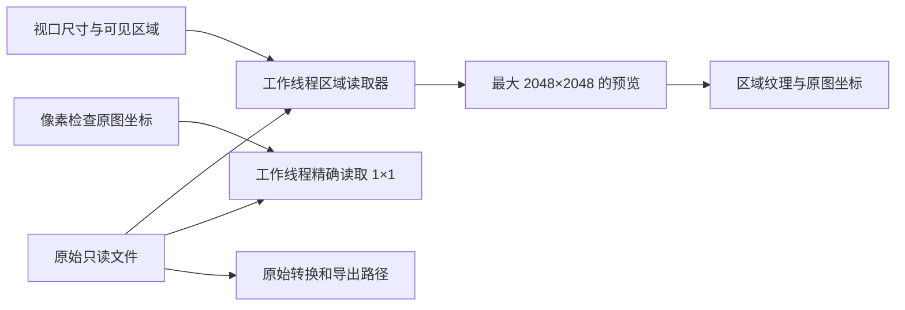

# 有界大图预览

## 决策与范围

大图预览不应以整张原图的 CPU/GPU 驻留作为打开前提。所有现有普通图片格式均接入按需预览。ImageDocument 以 `Limits::preview` 打开时只构建逻辑描述和子资源目录，使用 `decode_preview` 输出区域；此模式禁止调用完整 `decode`。GIF 使用独立的流式动画合成器。转换、预检和完整质量导出仍打开原始文件，禁止使用预览像素。

首屏显示全图低分辨率画面，并在当前文件、子资源、通道映射的预览期间保留为完整底图。停止缩放/平移 100ms 后后台更新可见区域；旧细节区域外立即显示底图，缩小到概览分辨率时统一使用底图。细节更新不阻塞视口，也不显示整页加载提示；更新期间发生的操作在任务结束后重新读取最新视口，不丢失最终请求。100% 使用原图尺寸计算。每边最多 2048 物理像素，并按通道数量及标量字节数进一步缩小；多通道 EXR 不会被转换成 8 位 RGB。平铺模式使用完整图的有界预览。GIF 切换帧时先读取当前帧的完整有界画布，暂停后再补充区域细节，避免不同帧的区域与底图混用。

| 格式 | 实际读取单位与语义 |
| --- | --- |
| JPEG（jpg/jpeg/jpe/jfif） | 使用 Qt 同版本的 libjpeg，选择不低于目标分辨率的 DCT 缩放，逐行读取并仅保留目标采样点；不分配完整裁剪区域。不自动应用 EXIF 旋转；保留灰度布局和原生尺寸采样。 |
| PNG | Qt 同版本的 libpng 逐行读取；支持 Adam7 隔行、调色板/tRNS、灰度/灰度 alpha、8/16 位；不保留整图解码缓冲。 |
| BMP/DIB | 未压缩行直接寻址；1/4/8 位调色板、16/32 位位域、24 位、上下原点和 OS/2 core BMP；RLE4/RLE8 顺序解释命令，仅写目标采样点。位域扩展与原 Qt 解码语义保持一致。 |
| ICO | 使用目录定位指定 entry。格式限制每个 entry 最多 256×256，验证目录与 payload 尺寸后由 Qt 解码该 entry，保留 PNG/DIB AND-mask 行为。 |
| TGA | 原始行、RLE 包、调色板和 16 位像素逐行读取；未压缩行可跳过；保留原点、灰度、真实通道及全零 alpha。 |
| TIFF | 只读所需瓦片，或顺序读取命中条带内的行；支持原有整数、half/float/double、平面布局、alpha 和多页目录；保留原有 orientation 元数据语义。 |
| WebP | libwebp 原生裁剪/缩放。可见区域对齐偶数原点；精确采样增加邻接像素，避免有损色度插值在裁剪边缘改变原值。动画 WebP 仍不在既有支持范围内。 |
| DDS | 只读映射容器，保留 mip/数组/立方体面/深度切片；原始像素直接寻址，压缩格式每次解压一个 4×4 块，保留原生数值和 sRGB 标签。legacy RGB24、调色板及紧凑布局按有界行交给原解码器展开；opaque 声明冲突仍以块流式校验全选中表面。 |
| HDR/RGBE | 顺序读取原始/RLE 扫描线；保持既有 RGBE 中点及 EXPOSURE 策略，输出 float32 RGB。 |
| EXR | 扫描线或命中瓦片读取；保留 part、命名通道、half/float/uint、负坐标 dataWindow 和独立 displayWindow。既有 deep/子采样通道限制保持。 |
| GIF | 按需坐标上的有界画布；LZW 字典及一行像素流式解码，不分配完整帧 patch；保持局部调色板、透明色、四遍隔行、disposal 0–3、帧延时和循环次数。区域变化后按原帧序重放到当前帧。 |

像素检查异步读取原图的单个像素，不能把降采样画面当作原始读数；文件身份校验防止混入外部修改后的像素。缩放和平移保留已锁定的原图读数。区域缓存将区域、目标尺寸加入键，最多保留 32 项。Windows 缓存预算为物理内存的 1/16，限制在 128–512 MiB，其他平台为 256 MiB；按需填充，不预先占用。取消、换文件和清空使用任务代次隔离过期结果。

已显示区域覆盖新视口且分辨率足够时直接复用，不重复解码。细节请求在预算允许时附带周围边缘，宽高最多扩大到 1.25 倍，让小幅平移继续使用现有纹理。区域尺寸变化只调整细节纹理，保留完整底图、uniform、sampler 和布局兼容的 GPU pipeline，避免反复上传底图和重建整套资源。

## 内存与限制

非 GIF 的目标分辨率按 `预算 / max(原生通道每像素字节数, 16)` 计算上限，完整概览预算保持 32 MiB，局部细节预算提高到 64 MiB；目标通道和上传缓冲分别受该预算约束，每边仍最多 2048 像素，与原图总像素数无关。GIF 最多保留 2048×2048 的采样画布，发布帧的通道加 float 上传约 80 MiB 上限，并保留必要的 disposal 备份。上述 LRU 预算计入缓存原生通道、上传缓冲和编码快照；同一时刻还可能持有完整底图、旧显示区域和解码工作区，因此缓存预算不是进程总内存上限。

预览通常使用只读文件映射；映射页由操作系统管理，其工作集不等于应用私有解码缓冲。JPEG/PNG/BMP/ICO 等 RasterFile 适配器可缓存当前文档的编码快照，大小最多为 LRU 预算的 1/4（正常桌面最多 128 MiB），并计入同一预算；创建快照后立即解除文件映射，避免跨请求持有文件句柄阻止源文件更新。其他适配器仍按请求打开，不缓存其映射文档。源身份 SHA-256 逐块扫描，后续请求按文件身份复用；文件身份变化后重新打开。Qt 分配限制仍为 32 MiB，常规完整解码预算仍为 512 MiB。

完整底图额外保留一份有界 CPU 预览和 GPU 纹理，区域缓存遵守上述自适应上限；不会因原图放大而扩大底图。更换文件、子资源或通道映射时建立新底图；检测到文件身份变化时重新读取全图概览，避免新旧内容混合。

保留资源保护：单条扫描线/瓦片/EXR 压缩块有工作单元限制（64 MiB），libtiff 仍有库分配限制；JPEG 渐进系数、WebP（尤其 lossless）的内部缓冲由编解码库决定，不承诺任意编码都具有严格固定的进程峰值内存。大尺寸不再单凭整图展开体积拒绝，但格式自身尺寸、损坏数据、过大的单个编码单元仍可能拒绝。顺序编码的 JPEG/PNG/HDR/RLE TGA/GIF 请求可能需要扫描到目标行或重放前序帧；取消在行/包/块之间生效。尚未构建磁盘金字塔。

## 验证入口

- `formaview_image_session_tests --preview-navigation ORIGINAL_JPEG OUTPUT_JSON`：32 MiB Qt 限制下验证未对齐 5001×5001 → 1536×1536 解码及 15 次区域/概览往返、底图身份和内存边界。原始故障图为 8868×8232 JPEG。
- `formaview_desktop_tests largePreviewKeepsWholeImageDuringNavigation`：8192×8192 JPEG 的原生 GPU 窗口中，在区域请求触发前和连续缩放/平移期间检查四角像素，确保旧细节范围之外仍显示底图。
- `formaview_image_session_tests --navigation-benchmark INPUT_DIRECTORY OUTPUT_JSON`：对三张原始 JPEG/TGA 各请求 12 个不同的 1101×901 原生区域，再重复同一序列；记录打开时间、冷/热请求耗时、缓冲复用次数及进程内存，断言第二遍 12/12 复用。
- `formaview_desktop_tests largeImageNavigationBenchmark`：设置上述样本目录环境变量，逐图执行 200 次程序驱动的缩放/平移，记录帧间隔与最近一次已同步操作到呈现的时间。输出 `FORMAVIEW_UI_TEST_ROOT/navigation-benchmark.json`。此指标不包含每个原生鼠标事件的完整延迟，也不保证所有输入均呈现。

- `formaview_image_session_tests --preview-samples INPUT_DIRECTORY OUTPUT_JSON`：只读样本、32 MiB Qt 限制、初始有界显示、精确坐标采样和 256×192 原生区域读取。
- `py -3 tests/large_preview_reference_tests.py INPUT_DIRECTORY OUTPUT_JSON`：Pillow 独立对比原始采样值与区域 RGBA 哈希。
- `py -3 tests/make_large_preview_fixtures.py NEW_DIRECTORY`：生成 18000×8000 JPEG、TGA；需准备约 450 MiB 磁盘和生成参考图所需内存。
- `formaview_desktop_tests boundedLargeImagePreview`：设置 `FORMAVIEW_LARGE_IMAGE_SAMPLES` 和隔离的 `FORMAVIEW_UI_TEST_ROOT`，验证原生视口、平移、100% 和像素锁定。
- `formaview_image_session_tests --preview-matrix DIRECTORY OUTPUT_JSON`：每个 entry 的首/末像素、原生区域、缩小预览与完整解码逐字节比较；比较标量、编码和子资源身份，并检查取消。JPEG/WebP 缩小输出采用 codec 滤波，不要求等于最近邻采样，但原生区域必须一致。无效样本须在完整/区域两条路径均拒绝，单独计为负例。
- `formaview_image_session_tests --make-preview-fixtures NEW_DIRECTORY`：生成 4096×2304 的 PNG8/16、BMP、TIFF8/float、WebP、DDS、扫描线/瓦片 EXR 和 HDR，需约 500 MiB 磁盘及完整参考解码内存。
- `python tests/make_preview_matrix_fixtures.py NEW_DIRECTORY [--large]`：Pillow/struct 独立生成 Adam7、灰度 alpha、位域/RLE/OS2 BMP、DIB、ICO、RLE TGA、GIF；`--large` 生成 4096×2304 GIF 和 RLE TGA。
- `formaview_image_session_tests --gif-preview-samples DIRECTORY OUTPUT_JSON` 后运行 `python tests/gif_preview_reference_tests.py OUTPUT_JSON`：Pillow 独立逐帧、逐区域比对 GIF，包括大画布、字典增长、disposal 和区域重放。

## 2026-11-16 缩放与平移回归

此前只验证能打开、100% 和一次平移，漏掉了未对齐的大范围缩小以及旧区域之外的 GPU 画面覆盖。原图 `{113,227,5001,5001} → 1536×1536` 在修改前稳定出现 `Unable to read image data`，修改后通过，未提高任何分配上限。

本地证据位于 `development/navigation-final*.json`、`development/navigation-complete*.json`、`development/navigation-complete-ui-tests.txt` 和 `development/navigation-ui-regression/`：原始 JPEG/TGA 三图的原生像素及 ROI 哈希通过 Pillow 独立比对；JPEG 15 次区域/全图往返和细化期间精确取样通过；4823 个格式样本、45 个特殊编码样本、10 个大图样本共 20012 个区域检查无失败；34 项 CPU 回归通过。ASan 与 UBSan 均重建并通过 JPEG 导航、34 项 CPU 回归及 GIF 当前帧底图/区域检查。取样使用独立的内容代次，区域更新不取消同一图片的有效取样请求。

原生 Windows D3D11（RTX 5090 D）桌面用例通过：三张原图共 180 次锚点缩放和平移、100%/适合窗口往返、像素锁定；8192×8192 JPEG 在请求防抖期间及连续操作中的四角像素均有完整底图。切图几何、悬停、精度、缓存失效、子资源/图层、再次固定取样的回归也通过，共 10 passed（含初始化和清理）、0 failed、0 skipped。此次结果不扩展为所有 GPU、DPI 或任意超大编码的保证。没有制作安装器或提升版本号。

## 2026-11-16 连续导航性能优化

同机 Release 对照，三张原图各 12 个原生区域再重复一遍；耗时包含异步请求轮询等待，不等同于纯 codec 时间。首次打开基本不变（JPEG 约 262 ms，两张 TGA 约 353–356 ms）。

| 样本 | 原冷/热请求均值 ms | 新冷/热请求均值 ms | 热缓冲复用 | 原/新私有内存 MiB |
| --- | --- | --- | --- | --- |
| 20250318-163508.jpg | 136.2 / 136.0 | 57.1 / 15.6 | 0/12 → 12/12 | 72.3 / 108.1 |
| T_Fire.tga | 46.7 / 53.2 | 48.0 / 15.6 | 0/12 → 12/12 | 81.1 / 111.5 |
| T_Fire2.tga | 49.1 / 49.0 | 47.8 / 15.7 | 0/12 → 12/12 | 81.1 / 111.6 |

原生 D3D11 同条件独立运行的导航基准中，三图帧间隔 P95 仍约 20.1–20.7 ms，最大间隔从约 22.7–23.9 ms 变为约 20.9–21.8 ms；最近已同步操作到呈现的 P95 有改善也有小幅波动，不据此宣称达到固定帧率。主要确定收益是减少重复解码、文件重新打开、GPU 资源重建及底图上传。顺序编码的首次区域读取仍受 codec 能力限制。

本轮证据：`development/navigation-perf-before.json`、`navigation-perf-verified.json`、`navigation-perf-ui-before/`、`navigation-perf-ui-after/` 及 `navigation-perf-ui-tests.txt`。Release 主程序和测试目标构建通过；原图像素/ROI 经 Pillow 独立比对；4823 + 45 + 10 个格式样本共 20012 个区域检查通过；34 项 CPU 回归包含 40 种映射的 LRU 淘汰及文件更新；JPEG 15 次区域往返、ASan/UBSan 的导航、CPU 回归及 GIF 比对通过。桌面 9 个实际用例及初始化/清理共 11 passed、0 failed、0 skipped，新增小幅平移不更换缓冲断言。保持 v0.1 修补范围，没有制作安装器或修改版本。
