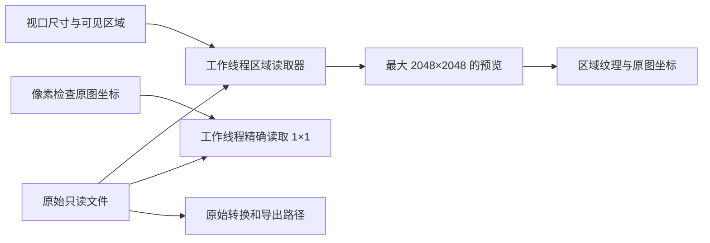

# 有界大图预览

## 决策与范围

大图预览不应以整张原图的 CPU/GPU 驻留作为打开前提。JPEG 和未压缩的 8-bit 灰度、24/32-bit 真彩色 TGA 超过 4M 像素时使用独立的预览读取器；其他编码继续走 ImageDocument。转换、预检和导出不使用预览像素。

选择区域读取而非继续提高全图预算：JPEG 使用 Qt JPEG handler 的 clip/scaled decode，TGA 逐行定位读取并保留上下/左右原点语义。首屏显示全图低分辨率画面，停止缩放/平移 100ms 后更新可见区域；100% 使用原图尺寸计算。超过 2048 物理像素的视口仍会缩小到该纹理上限。平铺模式使用完整图的有界预览。

像素检查异步读取原图的单个像素，不能把降采样画面当作原始读数；文件身份校验防止混入外部修改后的像素。缩放和平移保留已锁定的原图读数。区域缓存复用现有 256 MiB/8 项 LRU，并将区域、目标尺寸加入键。取消、换文件和清空使用任务代次隔离过期结果。

## 内存与限制

预览源通道加上传缓冲最多约 32 MiB/项；同一时刻还可能持有旧显示区域、缓存和临时 QImage。JPEG codec 自身的临时内存（尤其 progressive JPEG 系数）、文件身份扫描耗时不等同于这项保留量。Qt 单图分配限制恢复 32 MiB，常规 ImageDocument 的工作预算恢复 512 MiB。

该实现没有为所有格式构建磁盘金字塔。压缩/调色板/16-bit TGA、PNG、TIFF、EXR、DDS 等仍使用原有路径和资源限制；不能据此声称任意大小、任意编码均可预览。区域替换期间保留旧区域，其覆盖范围外暂显示背景；平移停止后加载新区域。原始 JPEG/TGA 元数据的完整检查仍由转换/预检路径提供。

## 验证入口

- `formaview_image_session_tests --preview-samples INPUT_DIRECTORY OUTPUT_JSON`：只读样本、32 MiB Qt 限制、初始有界显示、精确坐标采样和 256×192 原生区域读取。
- `py -3 tests/large_preview_reference_tests.py INPUT_DIRECTORY OUTPUT_JSON`：Pillow 独立对比原始采样值与区域 RGBA 哈希。
- `py -3 tests/make_large_preview_fixtures.py NEW_DIRECTORY`：生成 18000×8000 JPEG、TGA；需准备约 450 MiB 磁盘和生成参考图所需内存。
- `formaview_desktop_tests boundedLargeImagePreview`：设置 `FORMAVIEW_LARGE_IMAGE_SAMPLES` 和隔离的 `FORMAVIEW_UI_TEST_ROOT`，验证原生视口、平移、100% 和像素锁定。
